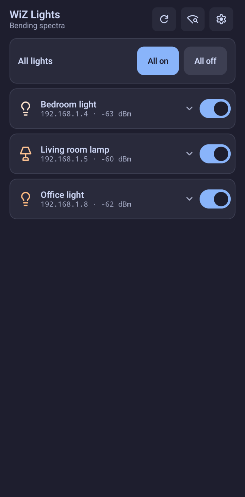
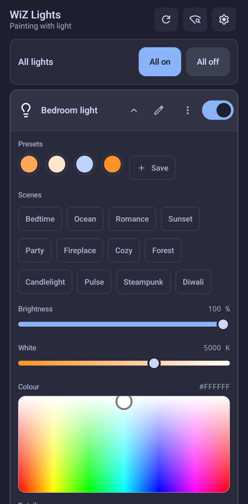
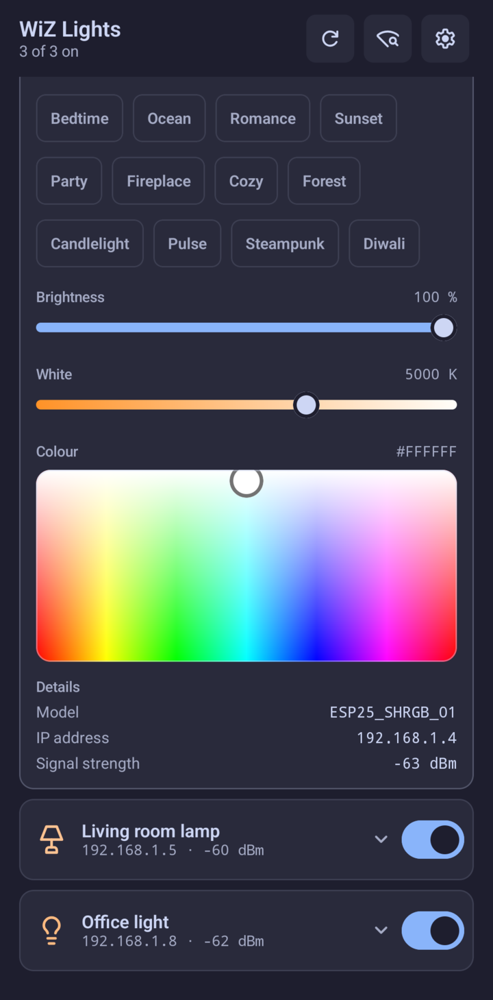
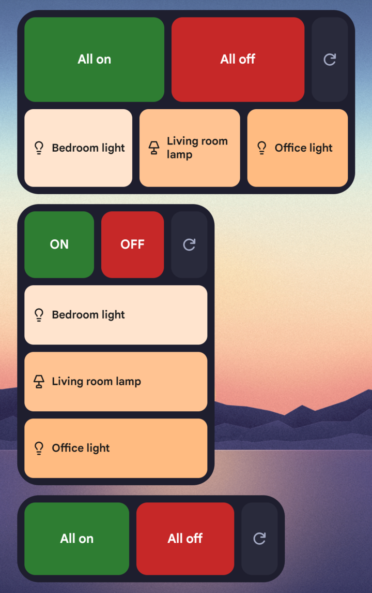
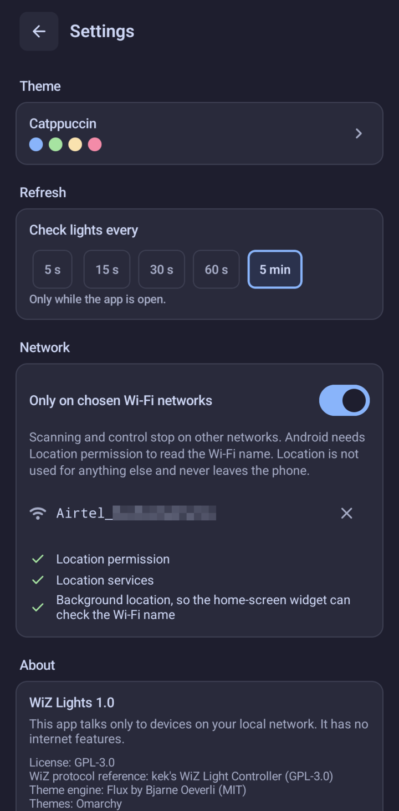
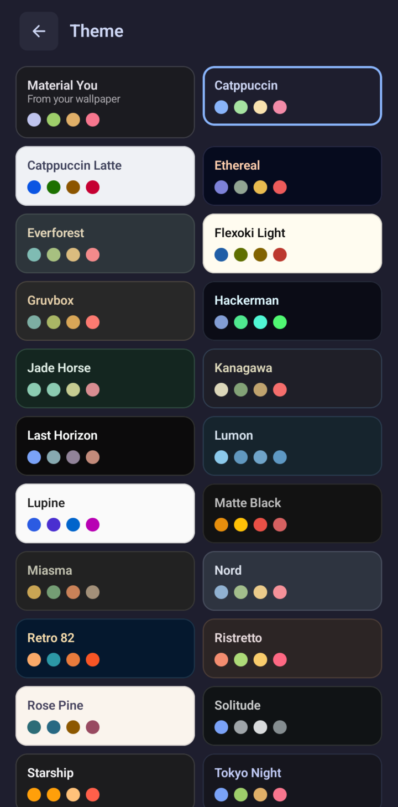

# WiZ Lights for Android

Control Philips WiZ bulbs over your local network. No account, no cloud, no internet.

- Scans the Wi-Fi (or Ethernet) network for WiZ bulbs, saves them by MAC and lets you name them
- Per-bulb power, brightness, white temperature (2200–6500 K), colour (hue × saturation plane), 12 scenes and saved presets
- All on / all off
- Resizable home-screen widget: 2×1 shows ON / OFF; wider adds a refresh button; more room adds light toggles in each bulb's colour. Widget taps also work with Battery Saver on
- Material You (Android 12+) and 23 stock Omarchy themes, styled like [Flux](https://github.com/bjarneo/flux); bulb or lamp icon per light
- Optional "only on chosen Wi-Fi networks" restriction

It is the Android counterpart of the [WiZ Lights plugin](https://github.com/kshatriya-abhay/omarchy-wiz-lights-plugin)
for the Omarchy shell, and uses the same `lights.json` / `presets.json` formats.

## Screenshots

<p>
  
  
  
</p>
<p>
  
  
  
</p>

## Install

Download `wiz-lights-v1.0.apk` from [Releases](../../releases) and open it on the phone (allow installing
from your browser or file manager when Android asks). Android 10 or newer.

Release APKs are signed with this certificate (SHA-256):

```
1b:08:d3:7f:31:5d:0e:e2:ee:dd:50:99:f4:0f:81:83:13:db:f4:7b:2e:ea:27:c2:6d:74:83:17:3d:b3:14:0b
```

Check a download with `apksigner verify --print-certs wiz-lights-v1.0.apk`. A debug build you made
yourself is signed with a different key, so uninstall it first; that removes the saved lights.

## Local network only

Android requires the `INTERNET` permission for any socket, including UDP on the LAN. The app enforces
"local only" in code:

- every socket is bound to the Wi-Fi or Ethernet network, never cellular. When a VPN covers the app, Android refuses that binding, and the socket follows the system routes instead (VPN apps normally route the LAN directly),
- every packet goes to, and every reply must come from, an address on that network's subnet or `255.255.255.255` (`net/AddressGuard.kt`),
- IP addresses are parsed as literals; no hostname is ever resolved,
- a bulb's state is only trusted, and power commands are only sent, when the device at the saved IP answers with the saved MAC, so on another network with the same address range nothing is switched,
- no HTTP library, analytics or crash reporting; a unit test fails the build if one appears on the classpath,
- cleartext HTTP is denied, backups are off.

The `WAKE_LOCK`, `RECEIVE_BOOT_COMPLETED` and `FOREGROUND_SERVICE` permissions in the APK come from
WorkManager, which Glance (the widget library) uses.

## Wi-Fi restriction

Off by default, and then the app needs no location permission. When you turn on **Settings → Network →
Only on chosen Wi-Fi networks**, Android requires location permission to read the Wi-Fi name, and
"Allow all the time" for the widget to check it in the background. Scanning and control are blocked on
other Wi-Fi networks. Ethernet is always allowed.

## Build

Requires JDK 17–21 and the Android SDK (platform 37.2).

```sh
./gradlew testDebugUnitTest      # JVM unit tests, including a fake bulb on loopback
./gradlew assembleDebug          # app/build/outputs/apk/debug/app-debug.apk
adb install -r app/build/outputs/apk/debug/app-debug.apk
```

### Release

The version is set in `app/build.gradle.kts` (`versionName`, `versionCode`).

- `./gradlew assembleStaging` builds the R8-shrunk release as `io.github.kshatriyaabhay.wizlights.staging`, signed with the debug key and installable next to the debug app, to smoke-test the release build.
- A signed release reads `keystore.properties` in the project root (git-ignored: `storeFile`, `storePassword`, `keyAlias`, `keyPassword`) or the `SIGNING_STORE_FILE`, `SIGNING_STORE_PASSWORD`, `SIGNING_KEY_ALIAS` and `SIGNING_KEY_PASSWORD` environment variables. Without them, `assembleRelease` produces an unsigned APK.
- Releases are built and signed locally; the key is not stored on GitHub. `.github/workflows/ci.yml` only runs the tests and lint on pushes to `main` and on pull requests.
- Publish: tag the commit (`git tag -a v1.0`), push the tag, and attach the APK as `wiz-lights-v1.0.apk` with its SHA-256 (`gh release create v1.0 wiz-lights-v1.0.apk`).

Check a release APK before publishing:

```sh
java -jar ~/Android/Sdk/build-tools/37.0.0/lib/apksigner.jar verify --print-certs app/build/outputs/apk/release/app-release.apk
~/Android/Sdk/build-tools/37.0.0/aapt2 dump badging app/build/outputs/apk/release/app-release.apk | grep -E "^package|application-label"
```

## Troubleshooting discovery

- Phone and bulbs must be on the same network; bulbs use 2.4 GHz.
- Turn off "AP isolation" / "client isolation" on the router.
- Turn on "Allow local communication" in the WiZ app.

## On-device checklist

The emulator can't reach LAN broadcast, so these are checked on a real phone:

1. Scan finds the same bulbs as `python3 wizctl.py discover` on the laptop.
2. Power, brightness, temperature, colour and each scene on an RGB bulb (and a white bulb if available).
3. A brightness/temperature/colour/scene command turns an off bulb on (`"state": true` is sent with it). Confirmed on `ESP25_SHRGB_01`, which also accepts brightness down to 1 % (the app keeps a 10 % floor) and clamps temperature to 2200–6500 K. If a bulb rejects the combined form, set `WizClient.combinedState = false`.
4. Rename and forget survive an app restart; a changed bulb IP is picked up by a scan.
5. Wi-Fi off, mobile data on: the app shows "Connect to Wi-Fi" and sends nothing.
6. With a VPN on, control still works.
7. Wi-Fi restriction: an allowed SSID works; another SSID blocks app and widget; declining background location shows the widget's "Open app" state.
8. Widget at 2×1, 3×1, 5×1, 2×2, 4×2, 4×4; taps work with the app swiped away and after a reboot.
9. Each theme: Lights screen, an expanded light, Settings, widget.

## License

GPL-3.0. See [LICENSE](LICENSE) and [NOTICE](NOTICE) for third-party code and credits.
WiZ is a trademark of Signify. This app is not affiliated with or endorsed by Signify.
